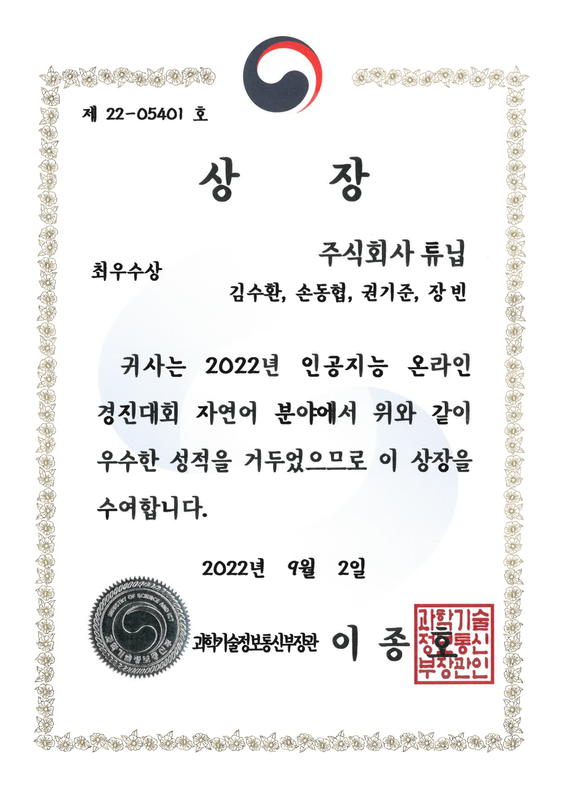
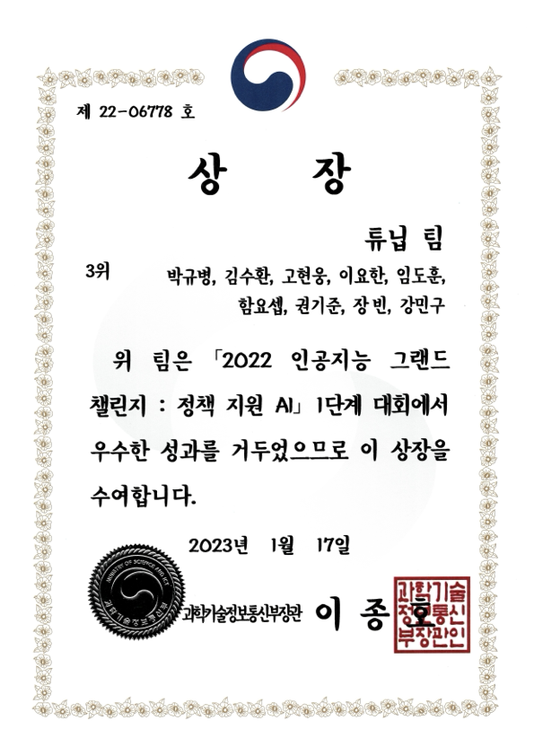

Hi, I'm Soohwan Kim, an AI Engineer.

I started my career in speech recognition and went on to build natural language processing systems and AI chatbot services. Today I research and develop the AI that keeps the Karrot marketplace running at Karrot (Daangn). I go by `sooftware` on GitHub and this blog, a blend of my name **Soo**hwan and so**ftware**. At work people call me Kaki, my English nickname: **K**im + **A**I + ~~**K**akao~~**K**arrot + A**I**.

## What I Do Now

### Karrot · ML Engineer (Apr 2026 – Present)

I work on the Operations Engineering team at Karrot, Korea's hyperlocal community platform used by more than 20 million people.

- **AI Agents** — Building **KAMP**, an internal platform for creating and operating multi-agent AI systems, along with algorithms that automatically optimize production agents such as our CS chatbot and their models and prompts.
- **Machine Learning** — Building and running a range of text ML pipelines: post classification, metadata extraction, report-handling automation, and more.
- **Model Serving** — Serving models in-house to automate many parts of our operations, with a focus on serving optimization for a large-scale consumer service.

## Experience

### TUNiB · Co-founder & CTO (Mar 2021 – Mar 2026)

Inspired by what GPT-3 promised, and wanting to grow and take on a real challenge while I was young, I co-founded TUNiB, an AI character startup, with colleagues from Kakao Brain. I started as AI Lead and became CTO in 2024. After giving it everything for the five years I had planned, I moved to Karrot to learn from building at a much larger scale.

- Raised a **3 billion KRW seed round** from Pearl Abyss Capital, DSC Investment, and Naver D2SF
- Led development of **DearMate**, an AI social network service
- Developed **Cheetah**, our in-house chatbot model
- Led development of an **AI Safety Guardrail** solution made up of hate speech, jailbreak, and compliance detection models — delivered to clients including KakaoBank and Wrtn, with the underlying research published at EMNLP
- Led an AI team of up to about 10 people, building everything from hiring and onboarding to an engineering culture of code review, experiment tracking, and deployment pipelines

### Kakao Brain · AI Engineer (Aug 2020 – Mar 2021)

I joined after the team lead came across [**KoSpeech**](https://github.com/sooftware/kospeech), the open-source speech recognition project I built as my graduation project. I owned the speech (ASR, TTS) and OCR modules of [**Pororo**](https://github.com/kakaobrain/pororo), an integrated natural language processing framework.

- Built Wav2Vec 2.0-based speech recognition models for Korean, English, and Chinese, including Korean pretraining
- Built a multilingual Text-To-Speech model

### Sogang University Spoken Language Lab · Undergraduate Researcher (Mar 2020 – Aug 2020)

I took part in speech recognition research in Professor Ji-Hwan Kim's lab at Sogang University and served as a teaching assistant for the speech recognition course in Samsung's AI Expert Program.

## Education

### Kwangwoon University (Mar 2014 – Feb 2021)

- Major: Electronics and Communication Engineering / Minor: Data Science
- GPA: 3.67 / 3.89 (Overall / Major)
- Awards & Scholarships
    - 2020 Graduation Project Exhibition, 1st place — President's Award
    - 2019, 2020 Samsong Scholarship
    - 2018, 2019 Academic Excellence Scholarship

I didn't major in computer science. My major, Electronics and Communication Engineering, covered semiconductors, computer engineering, and communications broadly: you studied everything in your second year, then picked a main track in your third, like a second job advancement in a game. Semiconductors didn't feel right for me, and I was sure coding was what I was made for, so I went all in on it.

The courses in my department weren't enough, so I minored in Data Science, which let me learn the then-trending fields of machine learning and deep learning. I wanted to combine the signal processing and CS from my major with the deep learning from my minor, so I chose speech recognition for my graduation project. It won first place at the graduation exhibition, earning the President's Award I had wanted to receive before graduating, and releasing it as [open source](https://github.com/sooftware/kospeech) naturally led to a job on a team I had long admired.

## Open Source

My GitHub projects have earned more than 5,000 stars in total, and I have over 500 followers. I was very active in open source up until the early days of the startup. Work has kept me too busy since then, but I hope to get back to it one day.

- [**Pororo**](https://github.com/kakaobrain/pororo) (1.3k+ ⭐) — An NLP library that solves 30+ tasks in a few lines of code
- [**OpenSpeech / KoSpeech**](https://github.com/openspeech-team/openspeech) (1.3k+ ⭐) — A framework for building speech recognition models across architectures and languages
- [**Conformer**](https://github.com/sooftware/conformer) (1.1k+ ⭐) — A PyTorch implementation of the Conformer paper
- [**Attentions**](https://github.com/sooftware/attentions) (500+ ⭐) — PyTorch implementations of attention mechanisms

## Publications

I think of myself as an engineer more than a researcher, but my work has naturally led to a few papers along the way.

- [**K-HATERS: A Hate Speech Detection Corpus in Korean with Target-Specific Ratings**](https://arxiv.org/abs/2310.15439) — Findings of EMNLP, 2023 (co-first author)
- [**Open-Source Toolkit for End-to-End Korean Speech Recognition**](https://www.sciencedirect.com/science/article/pii/S2665963821000026) — Software Impacts (Elsevier), 2021

## Awards

In TUNiB's early days, one of my biggest jobs was "bringing in money." I entered national AI competitions that came with commercialization grants and placed in every single one, winning the Minister of Science and ICT Award three times and securing 2.5 billion KRW in commercialization grants.

- 2023 ICT Fund Program, Outstanding Results — Minister of Science and ICT Award (Korean dialogue and commonsense dataset construction)
- 2022 National AI Grand Challenge (Policy-assisted AI) — **3rd place**, Minister of Science and ICT Award, 2 billion KRW grant
- 2022 National AI Online Competition (Machine Reading Comprehension) — **1st place**, Minister of Science and ICT Award, 200 million KRW grant
- 2021 National AI Grand Challenge (Speech Classification) — **3rd place**, IITP President's Award
- 2021 National AI Online Competition (Conversation Sentiment Analysis) — **1st place**, NIPA President's Award, 300 million KRW grant
- 2020 National AI Grand Challenge (Speech Understanding) — **3rd place**

## Things I Love

- **Weight training** — I keep my big-three total at around 400 kg and aim to keep improving, even a little at a time.
- **Travel** — I try to go abroad at least once a year to gain new experiences, and I enjoy both sightseeing and resort trips. So far I've been to the Maldives, Singapore, Malaysia, France, Switzerland, China, Japan, Vietnam, Thailand, Saipan, and the Philippines. I'd like to add at least one new country every year.
- **Food tours** — I love good food and a drink with people I like. My drink of choice is soju.
- **Coffee** — I drink two or three cups a day, almost always an Americano, and I enjoy working on my laptop or reading at a café.

## Contact

- Email: [sh951011@gmail.com](mailto:sh951011@gmail.com)
- GitHub: [github.com/sooftware](https://github.com/sooftware)
- LinkedIn: [linkedin.com/in/sooftware](https://www.linkedin.com/in/sooftware/)
